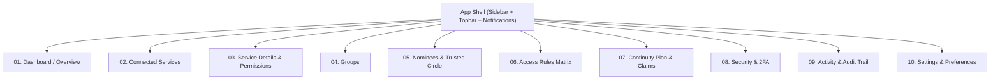

# PROJECT PLAN — MY VAULT
## Digital Continuity Dashboard | Semester 7 UEDP-5 Final Assignment

**Project Title:** My Vault  
**Domain:** Digital Legacy & Digital Continuity  
**Author:** Vidhi Ambade (Semester 7, B.Des User Experience Design)  
**Faculty In-Charge:** Prof. Kriti Kusum  
**Evaluation Scope:** 45 Marks — UX Solution Development, Validation & Case Study

---

## 1. Executive Summary & Problem Framing

### Core Design Question
> *How might people organise their fragmented digital lives and communicate clear, selective access preferences to trusted people for a future time when they can no longer manage those accounts themselves?*

### Problem Space (Grounding in UEDP-5 Research)
Modern personal lives are distributed across dozens of unlinked digital platforms—photos in Apple iCloud and Google Photos, financial records in bank portals and drives, communications in WhatsApp, and creative assets in cloud repositories. When incapacitation or death occurs, families encounter a binary access dilemma: either complete cryptographic lockout, or intrusive all-or-nothing credential sharing that violates personal privacy.

### Key Research Insights (Source: UEDP-5 Research Documents)
1. **Access is Not Binary:** Users overwhelmingly reject blanket account transfer. They demand selective delegation—e.g., sharing family vacation photographs while permanently locking personal messaging threads.
2. **Connecting $\neq$ Sharing:** Users hesitate to use continuity tools because they fear connecting an account immediately exposes files to family members. The interface must communicate that accounts remain private and inactive during lifetime.
3. **Cognitive Overload & Morbid Avoidance:** Death-oriented language induces psychological paralysis. The product must adopt a calm, dignified, proactive framing: *"Your digital life, organised."*
4. **Least-Privilege & Zero-Trust Defaults:** High-sensitivity information (private chats, direct messages, financial login credentials) must be excluded by default.

---

## 2. Information Architecture & Navigation Structure

The application is structured into a persistent desktop shell with 10 primary views, accessible via a persistent sidebar:

### Route & View Breakdown

| # | Route / View | Core Purpose & Interactive Capabilities |
|---|---|---|
| **01** | **Dashboard / Overview** | Default post-login command center. Hero health status ("Owner control active"), summary metrics, connected service overview, trusted nominees roster, continuity setup checklist, privacy guarantee card. |
| **02** | **Connected Services** | Catalog of supported cloud services (Google, Apple, Dropbox, Microsoft, Instagram, Facebook). Service search/filtering, connection status pills, and the **Connector Experience Modal**. |
| **03** | **Service Details & Permissions** | Deep inspection of an individual service. Category checkboxes, permission scopes, plain-language explanations, nominee assignments, and revoke/disconnect actions. |
| **04** | **Groups** | Organisational shortcuts (Social Media, Photos & Memories, Documents, Work & Projects). Group creation, service aggregation, category inheritance, and conflict resolution rules. |
| **05** | **Nominees** | Trusted circle roster. Nomination flow by email and relationship, scope assignment, invitation modal, simulated email invitation, and **demo verification code walkthrough**. |
| **06** | **Access Rules** | Master governance matrix displaying the multidimensional mapping between Service $\leftrightarrow$ Category $\leftrightarrow$ Group $\leftrightarrow$ Nominee $\leftrightarrow$ Activation Status. Filtering, editing, and exclusion toggles. |
| **07** | **Continuity Plan & Claims** | Explains the future activation protocol with a calm timeline stepper. Includes the **Simulated Continuity Claim Submission Flow** (claimant details, demo death certificate upload, pending review state, approval/rejection simulation). |
| **08** | **Security & 2FA** | Account sovereignty controls. Two-Factor Authentication status, passkeys, recent device sessions, authorized OAuth token review, and security audit log. |
| **09** | **Activity / Audit Log** | Immutable chronological audit trail of all owner events (linking, category changes, nominee invitations, simulated pings). |
| **10** | **Settings** | Owner profile, notifications, session management, export continuity specification, demo data reset. |

---

## 3. Key User Flows & Interactive Specifications

### Flow A: The Connector Experience (Connecting a Third-Party Service)
1. **Trigger:** Owner clicks *"Connect service"* in Dashboard or Connected Services.
2. **Provider Selection:** Modal displays searchable grid of services (Google Drive, Apple iCloud, Microsoft 365, Dropbox, Instagram, Facebook).
3. **Scope Explanation:** System explains what metadata will be requested in plain language.
4. **Simulated Authorization:** Clear *"Continue with [Provider]"* simulated OAuth screen (explicitly labeled as a non-credential collection prototype).
5. **Category Selection:** Owner selects which categories to include in the continuity plan (e.g., Photos included; Gmail inbox excluded).
6. **Confirmation:** System connects service, updates dashboard readiness, and issues a success toast notification.

### Flow B: Nominee Invitation & Email Verification Demo
1. **Trigger:** Owner clicks *"Add nominee"* in Nominees view.
2. **Details:** Owner enters Nominee Name, Email, Relationship (e.g., Sister, Partner, Attorney).
3. **Scope Assignment:** Assigns specific services, categories, or groups.
4. **Invitation Dispatch:** Prototype dispatches a simulated invitation email.
5. **Interactive Verification View:** Switchable demo view allowing the user to view the email, enter the demo verification code (e.g., `VAULT-8492`), and complete email verification.
6. **State Integrity:** Email verification marks email as verified, but leaves access in *"Pending continuity activation (Inactive during owner lifetime)"*.

### Flow C: Continuity Claim Submission & Review Simulation
1. **Context:** Dedicated simulator demonstrating how a claimant (e.g., family executor) submits an activation request in the future.
2. **Claim Submission:** Claimant submits contact info, relation, owner details, and uploads a sample demo certificate document.
3. **Review State Machine:** Claim enters *"Under Review"*. Owner/Evaluator can inspect the claim, request additional documentation, simulate approval, or reject fraudulent claims.
4. **Activation Gate:** Approved claims transition specific assigned categories to eligible status, while unassigned or private categories remain permanently locked.

---

## 4. Architectural Boundaries & Non-Goals
- **No Real Password Storage:** The prototype never asks for, stores, or transmits real platform passwords.
- **No Live API Scraping:** Uses client-side state machine with realistic mock data (`mockData.ts`) persisted in `localStorage` for seamless evaluation.
- **No Production Legal Claims:** Clearly distinguishes UX simulation from certified legal probate or cryptographic hardware tokens.

